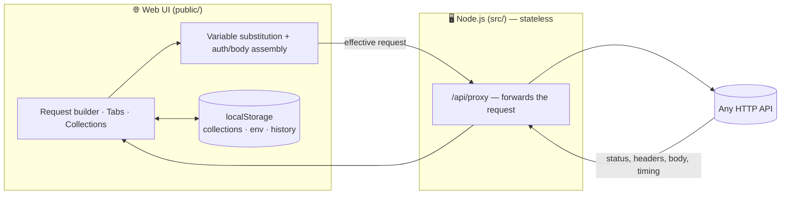

# 🧪 ReqLab — a lightweight API client

> A hostable, Postman-style API client you run yourself. Build, send, and
> inspect HTTP requests from a clean web UI, with collections, environments,
> variables, history, and code generation — backed by a small Node.js server
> that proxies requests so you're never blocked by browser CORS.

ReqLab is a single, dependency-light web app (one runtime dependency: Express).
No build step, no framework, no account — just `npm start`.

[](https://render.com/deploy?repo=https://github.com/gargshishirr/reqlab)

> 📖 For a full deep-dive — architecture, every file, the request lifecycle,
> the data model, security, and testing — see
> [docs/DOCUMENTATION.md](docs/DOCUMENTATION.md).

---

## ✨ Features

### Request building
- All HTTP methods: **GET, POST, PUT, PATCH, DELETE, HEAD, OPTIONS**
- URL bar with method selector and **Send**
- **Query params** editor with enable/disable, two-way synced with the URL
- **Headers** editor (enable/disable rows)
- **Request body**:
  - none
  - **raw** — JSON / Text / XML / HTML / JavaScript (+ one-click **Beautify** for JSON)
  - **x-www-form-urlencoded**
  - **form-data** (multipart, text fields)
- **Authorization**: No Auth · **Bearer Token** · **Basic Auth** · **API Key** (header or query)

### Response viewer
- Status (color-coded), response **time**, and **size**
- **Pretty** (JSON syntax-highlighted) · **Raw** · **Preview** (sandboxed HTML / inline images) · **Headers**
- One-click **Copy** of the response body
- Safe rendering — bodies are HTML-escaped and HTML previews run in a locked `sandbox` iframe (no script execution)

### Organize & reuse
- **Multiple tabs** with an unsaved-changes indicator
- **Collections** — save, open, rename, and delete requests
- **History** — every send is logged and can be re-opened
- **Environments & variables** — define `{{variables}}` and switch environments; variables resolve in the URL, params, headers, body, and auth
- **Code generation** — export the current request as **cURL** or **JavaScript fetch**
- **Import / Export** — ReqLab JSON, plus best-effort **Postman v2** collection import
- **Browser-only storage** — collections/environments/history/tabs are saved in **your own browser** (`localStorage`). They are **never sent to the server**, so tokens/secrets never touch the host (e.g. Render).
- Keyboard shortcut: **⌘/Ctrl + Enter** to send

### Backend
- **Proxy** (`POST /api/proxy`) forwards requests server-side to **bypass CORS** (the same reason the Postman/Insomnia desktop apps work), capturing status, headers, body, timing, and byte size
- **Stateless** — the server writes **nothing** to disk; it's a pure proxy
- Configurable timeout and request/response size limits
- For public instances: an **SSRF guard** (looks up where a domain really points and checks every redirect hop), a **demo-mode allow-list** of hosts, and a **rate limit**
- **Docker** + compose for one-command hosting

---

## 🏗️ How it works



The browser can't call arbitrary third-party APIs directly (CORS). So ReqLab
assembles the final request — resolving `{{variables}}`, applying auth, building
the body — and hands it to the local server, which performs the real request
with Node's `fetch` and returns everything the UI needs to display. The server
keeps **no state**; all your data lives in the browser.

---

## 📁 Project structure

```
reqlab/
├── src/
│   ├── server.js          # Express app: static site + stateless API
│   ├── config.js          # env-driven configuration
│   └── api/
│       ├── proxy.js       # the request-forwarding proxy (CORS bypass, redirects, size cap)
│       ├── guard.js       # SSRF guard + demo-mode allow-list
│       ├── rateLimit.js   # in-memory rate limit for public instances
│       └── routes.js      # health + proxy endpoints
├── public/                # the website (no build step)
│   ├── index.html
│   ├── css/styles.css
│   └── js/
│       ├── variables.js   # {{var}} resolution
│       ├── codegen.js     # cURL / fetch generation
│       ├── highlight.js   # safe HTML escape + JSON highlighting
│       ├── api.js         # talks to the backend
│       └── app.js         # main UI logic (tabs, requests, collections, …)
├── test/reqlab.test.js    # backend test suite
├── Dockerfile · docker-compose.yml
├── render.yaml            # one-click public demo on Render
├── .env.example
└── package.json
```

---

## 🚀 Quick start

**Requirements:** Node.js 18+ (uses the built-in `fetch`).

```bash
npm install
npm start
# → open http://localhost:4000
```

The app opens with a sample request (`GET https://jsonplaceholder.typicode.com/todos/1`).
Click **Send** to see it work.

---

## 🕹️ Using ReqLab

1. **Pick a method and enter a URL** (use `{{baseUrl}}` etc. for variables).
2. Add **Params**, **Headers**, **Authorization**, or a **Body** in the tabs below.
3. Click **Send** (or **⌘/Ctrl+Enter**).
4. Inspect the response: **Pretty / Raw / Preview / Headers**, plus status, time, and size.
5. **Save** the request into a **Collection** for reuse, or grab it later from **History**.
6. Click **`</>`** to copy the request as **cURL** or **fetch**.

### Environments & variables
- Click **Manage** (top bar) to create environments and variables.
- Reference them anywhere as `{{name}}` — they resolve at send time.
- Switch the active environment from the dropdown in the header.

### Import / Export
- **Export** downloads your collections + environments as JSON.
- **Import** accepts a ReqLab export or a **Postman v2** collection (best-effort).

---

## 🔌 API reference

Base URL: `http://localhost:4000/api`

| Method | Endpoint | Description |
| --- | --- | --- |
| `GET` | `/health` | Liveness probe |
| `POST` | `/proxy` | Forward a request and return the response |

> That's the entire API. ReqLab's server is **stateless** — it has no storage
> endpoints. Collections, environments, and history live in your browser's
> `localStorage`, never on the server.

### `POST /api/proxy`

Request body:

```json
{
  "method": "POST",
  "url": "https://api.example.com/users",
  "headers": { "Authorization": "Bearer …", "Content-Type": "application/json" },
  "body": "{\"name\":\"Ada\"}",
  "timeout": 30000
}
```

Response:

```json
{
  "ok": true,
  "status": 201,
  "statusText": "Created",
  "headers": { "content-type": "application/json" },
  "contentType": "application/json",
  "time": 142,
  "size": 64,
  "body": "{ … }"
}
```

Errors (timeout, DNS failure, blocked host, bad URL) return an `error` field
with an appropriate HTTP status.

Try it with curl:

```bash
curl -X POST http://localhost:4000/api/proxy \
  -H 'Content-Type: application/json' \
  -d '{"method":"GET","url":"https://jsonplaceholder.typicode.com/todos/1"}'
```

---

## ⚙️ Configuration

Copy `.env.example` to `.env` (all optional):

| Variable | Default | Description |
| --- | --- | --- |
| `PORT` | `4000` | HTTP port |
| `HOST` | `0.0.0.0` | Bind address |
| `PROXY_TIMEOUT_MS` | `30000` | Default per-request timeout |
| `PROXY_MAX_TIMEOUT` | `120000` | Upper bound on per-request timeout |
| `MAX_RESPONSE_BYTES` | `26214400` | Max response kept for display (25 MB) |
| `MAX_BODY_BYTES` | `52428800` | Max size of a request sent to ReqLab itself (50 MB) |
| `BLOCK_PRIVATE_HOSTS` | `false` | Block proxying to localhost/private IPs, including domains that resolve to them and redirects that lead to them |
| `ALLOWED_HOSTS` | *(empty)* | Demo mode: only call these hosts (comma separated; `*.example.com` allows subdomains). Empty allows any host |
| `RATE_LIMIT_PER_MINUTE` | `0` | Proxied requests per visitor per minute (`0` = no limit) |
| `RATE_LIMIT_TOTAL_PER_MINUTE` | `0` | Proxied requests per minute for the whole server (`0` = no limit) |
| `CLIENT_IP_HEADER` | *(empty)* | Header your host's proxy sets to the visitor's IP, for the rate limit (`cf-connecting-ip` on Render). Never use one visitors can set themselves |

> There is no data directory to configure — the server stores nothing.

---

## ☁️ Hosting

### Docker (recommended)

```bash
docker compose up --build
# → http://localhost:4000
```

Or:

```bash
docker build -t reqlab .
docker run -p 4000:4000 reqlab
```

No volume is needed — the server is stateless.

### Render (one click)

[](https://render.com/deploy?repo=https://github.com/gargshishirr/reqlab)

The button uses [`render.yaml`](render.yaml), which runs ReqLab as a **public
demo** on the free plan: the SSRF guard is on, the proxy only calls a short
list of well-known test APIs (`ALLOWED_HOSTS`), and requests are rate limited.
To use your instance for any API, clear `ALLOWED_HOSTS` in the Render
dashboard — but only if you also put it behind a login, or it becomes an open
proxy that anyone can use. A free Render service sleeps after 15 idle minutes
and takes about a minute to wake up.

### Any Node host (Render, Railway, Fly.io, a VPS…)

- **Build:** `npm install`
- **Start:** `npm start`
- The app reads `process.env.PORT`. **No persistent disk is required** — the
  server keeps no state. Your collections/environments/history live in your
  browser, so nothing of yours is written to the host.

> **Where does my data go when I host on Render?** Nowhere on Render. The server
> never writes to disk; your data stays in your browser's `localStorage` on the
> machine you use ReqLab from.

> **If you expose ReqLab publicly,** set `BLOCK_PRIVATE_HOSTS=true`. The proxy
> forwards whatever URL it's given (that's the whole point of an API client), so
> an open instance could be used to reach internal services (SSRF). The guard
> looks up every domain name and refuses private addresses, and it checks each
> redirect hop as well. For local/personal use you can leave it off so you can
> test your own `localhost` APIs. A public instance should also use
> `ALLOWED_HOSTS` and the rate limit (as `render.yaml` does), or sit behind
> authentication.

---

## 🧪 Testing

```bash
npm test
```

The suite covers the SSRF guard (IPv6 forms, IPv4-mapped addresses, domains
that resolve to private addresses, redirects to private hosts), the demo-mode
allow-list, header sanitization, redirect following (303 → GET, credentials
dropped across sites), the response size cap, the rate limit, and an
end-to-end proxy integration test (including the stateless behaviour — no
`/api/store` endpoint) against a local target server.

---

## 🔐 Security notes

- **The server stores nothing.** Collections, environments, and history live
  only in your browser's `localStorage` — tokens/secrets never reach the host.
- Response bodies are **HTML-escaped** before display; the **Preview** tab renders
  HTML inside a fully locked `sandbox` iframe (no script execution) — so a hostile
  response can't run code in the app.
- Hop-by-hop headers (`Host`, `Content-Length`, `Connection`, …) are stripped
  before forwarding.
- The proxy is intended for **trusted, local/personal use**, like every API
  client. If you host it publicly, use `BLOCK_PRIVATE_HOSTS`, `ALLOWED_HOSTS`
  and the rate limit, or an auth layer.
- Known limit of the SSRF guard: it looks up a domain and then lets `fetch`
  connect, and `fetch` looks the name up again. A domain that switches to a
  private address between the two lookups (DNS rebinding) could slip through.
  `ALLOWED_HOSTS` closes that gap for public demos.

---

## 📄 License

MIT.
