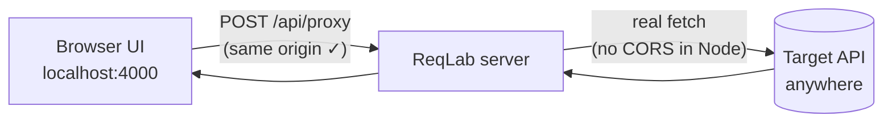
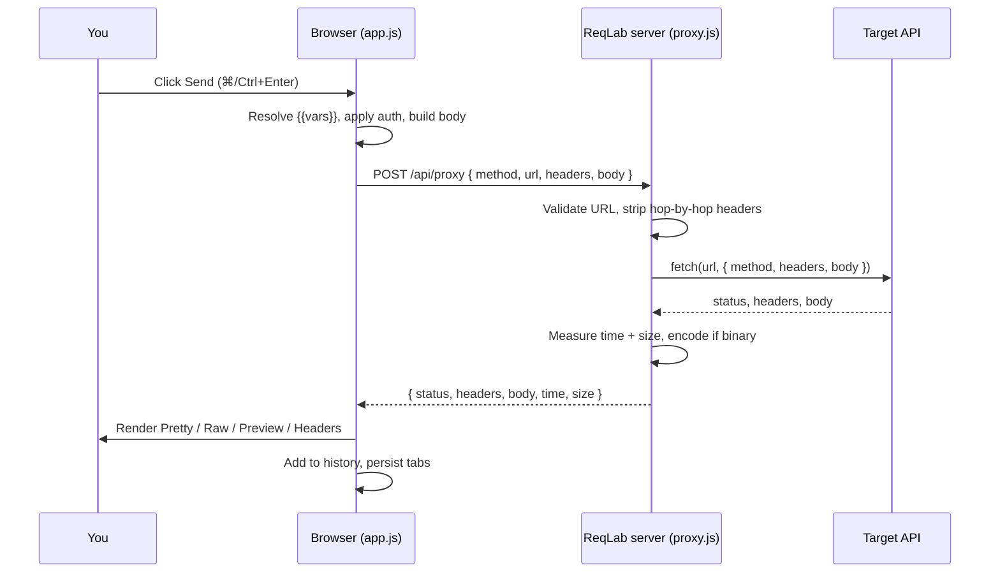

# 🧪 ReqLab — Complete Documentation

This document explains **everything** that was built for ReqLab: what it is, why
each piece exists, how the parts fit together, and how it was verified. It's a
companion to the [README](../README.md) — the README is the quick start, this is
the deep dive.

---

## Table of contents

1. [What ReqLab is](#1-what-reqlab-is)
2. [The core problem it solves (CORS)](#2-the-core-problem-it-solves-cors)
3. [Full feature list](#3-full-feature-list)
4. [High-level architecture](#4-high-level-architecture)
5. [The request lifecycle, step by step](#5-the-request-lifecycle-step-by-step)
6. [Project structure](#6-project-structure)
7. [Backend — file by file](#7-backend--file-by-file)
8. [Frontend — file by file](#8-frontend--file-by-file)
9. [Data model](#9-data-model)
10. [Security model](#10-security-model)
11. [Testing & verification](#11-testing--verification)
12. [Hosting & deployment](#12-hosting--deployment)
13. [Design decisions & trade-offs](#13-design-decisions--trade-offs)
14. [Possible extensions](#14-possible-extensions)

---

## 1. What ReqLab is

ReqLab is a **self-hosted, Postman-style API client**. It's a web app where you
build HTTP requests (method, URL, params, headers, auth, body), send them, and
inspect the response — with collections, environments, variables, history, and
code generation.

It is intentionally **small and dependency-light**:

- **One runtime dependency** — Express.
- **No frontend framework, no build step** — plain HTML/CSS/JavaScript served
  statically.
- **No database** — persistence is a single JSON file.
- **No account / login** — you run it; it's yours.

The whole thing boots with `npm start` and runs on Node.js 18+ (it relies on
Node's built-in `fetch`).

---

## 2. The core problem it solves (CORS)

A browser **cannot** freely call arbitrary third-party APIs from a web page.
The **Same-Origin Policy** and **CORS** (Cross-Origin Resource Sharing) block a
page served from `localhost:4000` from reading a response from, say,
`api.github.com` unless that API explicitly allows your origin. Most APIs don't.

This is exactly why the Postman and Insomnia _desktop_ apps exist — they make
requests from a native process, not a browser tab, so CORS doesn't apply.

ReqLab solves it the same way a hosted API client does: with a **server-side
proxy**. The browser UI never calls the target API directly. Instead it sends
the fully-assembled request to ReqLab's own backend (same origin, no CORS
problem), and the backend performs the real request with Node's `fetch` and
returns the result.



---

## 3. Full feature list

Everything below is implemented and working.

### Request building

- All HTTP methods: **GET, POST, PUT, PATCH, DELETE, HEAD, OPTIONS**.
- URL bar with a method selector and **Send**.
- **Query params** editor (enable/disable per row), kept **two-way in sync** with
  the URL — edit the URL and the rows update; edit the rows and the URL updates.
- **Headers** editor with enable/disable per row.
- **Request body** modes:
  - `none`
  - `raw` — JSON / Text / XML / HTML / JavaScript, with a one-click **Beautify**
    for JSON, and an auto `Content-Type` based on the chosen sub-type.
  - `x-www-form-urlencoded` — key/value editor, URL-encoded on send.
  - `form-data` — multipart with text fields (the body and boundary are built in
    the browser).
- **Authorization**:
  - No Auth
  - **Bearer Token** → `Authorization: Bearer <token>`
  - **Basic Auth** → `Authorization: Basic base64(user:pass)`
  - **API Key** → added as a **header** or a **query param** (your choice)

### Response viewer

- **Status** (color-coded by 2xx/3xx/4xx/5xx/error), **time** (ms), and **size**.
- Four views: **Pretty** (JSON syntax-highlighted), **Raw**, **Preview**
  (sandboxed HTML render / inline image), **Headers** (table).
- One-click **Copy** of the body.
- A draggable **divider** to resize the request/response split.

### Organize & reuse

- **Multiple request tabs**, each with an unsaved-changes dot.
- **Collections** — save, open, rename, and delete requests.
- **History** — every send is recorded and can be re-opened in a new tab.
- **Environments & variables** — define `{{variables}}`; they resolve in the URL,
  params, headers, body, and auth at send time. Switch environments from the
  header dropdown.
- **Code generation** — export the current request as **cURL** or **JavaScript
  fetch**.
- **Import / Export** — ReqLab's own JSON format, plus best-effort **Postman v2**
  collection import.
- **Browser-only storage** — collections/environments/history and open tabs are
  all saved in **your browser's `localStorage`**. Nothing is sent to the server
  to be stored, so tokens/secrets never touch the host.
- **Keyboard shortcut** — `⌘/Ctrl + Enter` sends the active request.

### Backend

- A **proxy** endpoint that forwards requests and reports status, headers, body,
  timing, and byte size.
- **Stateless** — the server writes nothing to disk; there is no storage endpoint.
- Configurable **timeout**, **max response size**, and an optional **SSRF guard**
  that blocks requests to localhost/private addresses.
- **Docker** + compose for one-command hosting.

---

## 4. High-level architecture

```mermaid
flowchart TB
    subgraph Browser["🌐 Browser (public/)"]
        direction TB
        APP[app.js — state, tabs, editors, rendering]
        VARS[variables.js — {{var}} resolution]
        CODE[codegen.js — cURL / fetch]
        HL[highlight.js — escape + JSON colors]
        API[api.js — backend client]
    end

    subgraph Server["🖥️ Node.js (src/) — stateless"]
        direction TB
        SRV[server.js — Express app]
        RT[api/routes.js]
        PX[api/proxy.js — the CORS bypass]
        CFG[config.js — env config]
    end

    TARGET[(Any HTTP API)]
    LS[(browser localStorage<br/>collections · env · history · tabs)]

    APP --> VARS & CODE & HL & API
    APP <--> LS
    API -->|/api/proxy| RT --> PX --> TARGET
    SRV --> RT
    SRV --> CFG
```

**Separation of concerns:**

- The **browser** owns everything about _building_ a request, _displaying_ a
  response, and _storing_ your data. It resolves variables, applies auth,
  assembles the body, renders the result, and persists to `localStorage`.
- The **server** is deliberately "dumb" and **stateless**: it forwards whatever
  fully-formed request it's handed and stores nothing. This keeps the security
  surface small and the logic easy to follow.

---

## 5. The request lifecycle, step by step

When you click **Send**, here's exactly what happens:

1. **Read the active tab's request model** — method, URL, params, headers, auth,
   and body (a plain JS object held in memory).

2. **Build the "effective" request** (`buildEffective` in `app.js`):
   - Resolve `{{variables}}` against the active environment.
   - Apply **auth**: add an `Authorization` header (Bearer/Basic) or inject the
     API key into a header or the query string.
   - Assemble the **body** based on the mode and set a default `Content-Type`
     (unless you already supplied one):
     - `raw` → the text as-is, content type from the sub-type.
     - `urlencoded` → `key=value&...`, URL-encoded.
     - `form-data` → a multipart payload with a generated boundary.

3. **POST it to the local proxy** (`api.js` → `POST /api/proxy`) as JSON:
   `{ method, url, headers, body, timeout }`. This call is same-origin, so the
   browser allows it.

4. **The server forwards it** (`proxy.js`):
   - Validate the URL and protocol; optionally block private hosts.
   - Strip hop-by-hop headers (`Host`, `Content-Length`, `Connection`, …).
   - Run `fetch` with an `AbortController` timeout, following redirects.
   - Read the full response into a buffer; measure **time** and **size**.
   - Return `{ ok, status, statusText, headers, contentType, time, size, body }`.
     Images come back base64-encoded (`bodyBase64`) for inline preview; oversized
     bodies are truncated with a `truncated` flag.

5. **The browser renders the response** (`renderResponse` in `app.js`):
   - Status/time/size in the meta bar.
   - **Pretty** view: if it looks like JSON, parse + re-stringify + syntax
     highlight; otherwise show text.
   - **Raw**, **Headers** (table), and **Preview** (sandboxed iframe for HTML, or
     an `` for images).

6. **Record history** and persist tabs — both to the browser's `localStorage`.



---

## 6. Project structure

```
reqlab/
├── src/
│   ├── server.js          # Express app: serves the site + stateless API, graceful shutdown
│   ├── config.js          # env-driven config (+ tiny .env loader)
│   └── api/
│       ├── proxy.js       # the request-forwarding proxy (CORS bypass + SSRF guard)
│       └── routes.js      # wires /health and /proxy
├── public/                # the website (no build step)
│   ├── index.html         # full UI markup
│   ├── css/styles.css     # dark teal/sky theme
│   └── js/
│       ├── variables.js   # {{var}} substitution helper
│       ├── codegen.js     # cURL / fetch snippet generation
│       ├── highlight.js   # HTML-escaping + JSON syntax highlighting
│       ├── api.js         # thin client for the backend proxy
│       └── app.js         # main UI logic + localStorage persistence
├── test/
│   └── reqlab.test.js     # backend test suite (node:test)
├── Dockerfile             # container image
├── docker-compose.yml     # one-command hosting
├── .dockerignore
├── .env.example           # documented configuration template
├── .gitignore
├── package.json
└── README.md
```

---

## 7. Backend — file by file

### `src/config.js`

Centralizes all configuration. It includes a **minimal `.env` loader** (so there
is no `dotenv` dependency) and exposes typed values with sensible defaults:
`port`, `host`, `proxyTimeoutMs`, `proxyMaxTimeout`, `maxResponseBytes`, and
`blockPrivateHosts`. Everything has a zero-config default, so the app runs
immediately with no `.env` at all.

### Storage — there is none on the server

ReqLab's server is **stateless**: it never writes to disk. All of your data
(collections, environments, history, and open tabs) is stored in the browser's
`localStorage` by `app.js`, under two keys (`reqlab_store_v1` and
`reqlab_tabs_v1`). The practical consequences:

- **Your tokens/secrets never reach the host.** When you host ReqLab (e.g. on
  Render), nothing of yours is written there — your data lives on the machine
  whose browser you use.
- History stores the **unresolved** URL (keeping `{{variables}}` as-is), so a
  secret that a variable resolves to — like an API key in a query string — is
  never recorded.
- The trade-off is no cross-device sync: your data is tied to one browser
  (exactly like a local desktop app).

### `src/api/proxy.js`

The heart of the app — and the reason it works. `createProxyHandler(config)`
returns an Express handler that:

- **Validates** the request: requires a URL, parses it, allows only `http:`/
  `https:`, and (if `blockPrivateHosts` is on) rejects loopback/private targets.
- **Sanitizes headers** via `sanitizeHeaders`, removing hop-by-hop and managed
  headers (`Host`, `Content-Length`, `Connection`, `Accept-Encoding`, etc.) that
  must not be forwarded verbatim.
- **Forwards** with `fetch`, using an `AbortController` for a bounded timeout
  (capped by `proxyMaxTimeout`) and following redirects.
- **Measures** elapsed time and full byte size, then returns a structured JSON
  payload. Images are returned as base64 (`bodyBase64` + `isBinary`) so the UI
  can preview them; bodies larger than `maxResponseBytes` are truncated with a
  `truncated: true` flag.
- **Maps errors** to meaningful HTTP statuses: `504` for timeouts, `502` for DNS/
  connection/TLS failures (with the underlying error code), `400`/`403` for bad
  or blocked URLs.

It also exports `isPrivateHost` and `sanitizeHeaders` as pure functions so they
can be unit-tested directly.

### `src/api/routes.js`

Builds the Express router and wires just two endpoints:

- `GET  /api/health` — liveness probe.
- `POST /api/proxy` — the forwarding handler above.

There is **no storage endpoint** — the server is stateless. A small `handle()`
wrapper ensures any thrown error becomes a clean `400 { error }` JSON response
instead of an unhandled crash.

### `src/server.js`

The entry point. It:

- Creates the proxy handler from `config`.
- Configures Express with large body limits (50 MB) so big payloads work.
- Mounts the API under `/api`, with a JSON 404 for unknown API routes.
- Serves the static site from `public/` with an SPA fallback to `index.html`.
- Starts an HTTP server, prints a friendly banner (URL, that storage is
  stateless, whether the SSRF guard is on), and installs **graceful shutdown**
  on `SIGINT`/`SIGTERM`.

---

## 8. Frontend — file by file

### `public/index.html`

The full markup: header (brand, environment picker, import/export), a sidebar
(Collections / History tabs), the request builder (URL bar, Params/Auth/Headers/
Body sub-tabs), the response pane (Pretty/Raw/Preview/Headers), and three modals
(Save, Environments, Code). Scripts are loaded in dependency order at the end.

### `public/js/variables.js` → `window.RL_vars`

Variable substitution. `resolve(str, map)` replaces `{{name}}` tokens using a
key→value map; **unknown variables are left untouched** so you can see what's
unresolved. `mapFromEnv(env)` builds the map from an environment's enabled
variables. `referenced(str)` lists which variables a string uses.

### `public/js/codegen.js` → `window.RL_codegen`

Turns an _effective_ request into a snippet. `curl()` builds a multi-line
`curl -X … -H … --data …` command with proper shell quoting; `fetchSnippet()`
builds an `await fetch(url, { … })` example. Both consume the same assembled
request the proxy receives, so the generated code matches what ReqLab actually
sends.

### `public/js/highlight.js` → `window.RL_highlight`

Safety + presentation. `escapeHtml()` escapes `& < > " '` so response bodies can
never inject markup. `highlightJSON()` **escapes first**, then wraps tokens
(keys, strings, numbers, booleans, null) in `<span class="tok-…">` for coloring.
Because escaping happens before any markup is added, highlighting is XSS-safe.

### `public/js/api.js` → `window.RL_api`

A thin wrapper over `fetch` with a single method: `proxy(payload)` calls
`POST /api/proxy` (and returns the payload, which may carry a handled `error`
rather than throwing). There are no storage calls — the server has no store.

### `public/js/app.js` → the main application

This is where most of the UI logic lives. Key responsibilities:

- **State model** — `state` holds tabs, collections, environments, history, and
  the active selections. A request is a plain object: `{ method, url, params,
headers, auth, body }`.
- **Tabs** — open/close/switch, an unsaved **dirty** dot, and restoration from
  `localStorage` on reload.
- **Reusable key/value editor** (`renderKV`) — used for params, headers,
  urlencoded, form-data, and environment variables. It always shows one "ghost"
  row that promotes to a real row as you type, with enable/disable and delete.
- **URL ↔ params two-way sync** — editing either side updates the other, while
  **preserving `{{variables}}`** through encoding.
- **Auth & body assembly** (`buildEffective`) — described in the lifecycle above.
- **Response rendering** — Pretty/Raw/Preview/Headers, status coloring, sizes,
  truncation banners, and a **sandboxed iframe** for HTML previews.
- **Collections, History, Environments, Save/Code modals, Import/Export** —
  including a `convertPostman()` that maps a Postman v2 collection into ReqLab's
  model.
- **Persistence** — everything (collections, environments, history, tabs) is
  saved to the browser's `localStorage`; nothing is sent to the server.

---

## 9. Data model

The browser's `localStorage` store (key `reqlab_store_v1`) is a single JSON object:

```jsonc
{
  "collections": [
    {
      "id": "ABC123",
      "name": "My API",
      "requests": [
        {
          "id": "REQ1",
          "name": "Get user",
          "request": {
            /* request model */
          },
        },
      ],
    },
  ],
  "environments": [
    {
      "id": "ENV1",
      "name": "Production",
      "variables": [
        {
          "key": "baseUrl",
          "value": "https://api.example.com",
          "enabled": true,
        },
      ],
    },
  ],
  "history": [
    {
      "id": "H1",
      "ts": 1718000000000,
      "method": "GET",
      "url": "…",
      "status": 200,
      "ok": true,
      "request": {
        /* … */
      },
    },
  ],
}
```

The **request model** (used in tabs, collections, and history) looks like:

```jsonc
{
  "method": "POST",
  "url": "https://api.example.com/users?page=2",
  "params": [{ "key": "page", "value": "2", "enabled": true }],
  "headers": [
    { "key": "Accept", "value": "application/json", "enabled": true },
  ],
  "auth": {
    "type": "bearer",
    "token": "{{token}}",
    "username": "",
    "password": "",
    "key": "",
    "value": "",
    "addTo": "header",
  },
  "body": {
    "mode": "raw",
    "raw": "{ \"name\": \"Ada\" }",
    "rawType": "json",
    "formData": [],
    "urlencoded": [],
  },
}
```

---

## 10. Security model

ReqLab is an API client, so it intentionally sends requests anywhere — but the
implementation is careful about the things that matter:

- **The server stores nothing.** It's stateless — collections, environments, and
  history live only in your browser's `localStorage`. Your tokens and secrets are
  never written to the host's disk, so a hosted instance (e.g. on Render) holds
  none of your data.
- **Response rendering is XSS-safe.** Every value shown in the UI is
  HTML-escaped before display. The **Preview** tab renders HTML inside an
  `<iframe sandbox>` with **no allowances**, so response scripts cannot execute
  or touch the ReqLab page.
- **Header hygiene.** Hop-by-hop and managed headers are stripped before
  forwarding, preventing malformed/duplicated framing.
- **Optional SSRF guard.** `BLOCK_PRIVATE_HOSTS=true` makes the proxy refuse
  loopback and private-range targets (`127/8`, `10/8`, `172.16–31`, `192.168`,
  link-local, IPv6 ULA/loopback). It's **off by default** so local development
  against your own `localhost` APIs works; turn it **on** for any public
  deployment. Note it matches on the hostname text, so a determined attacker
  could bypass it via a domain that resolves to a private IP or a redirect.
- **Bounded resource use.** Per-request timeouts (capped server-side) and a
  max-response-size limit protect the server from hung or huge responses.
- **The honest caveat.** A publicly exposed proxy can be abused to reach internal
  services, and there is **no authentication**. For anything beyond
  local/personal use, enable the SSRF guard and put ReqLab behind authentication.
  This is called out in the README too.

---

## 11. Testing & verification

### Automated tests (`npm test`, `node:test`)

All passing:

- `isPrivateHost` correctly classifies loopback / private / public addresses
  (including the `172.16–31` boundary).
- `sanitizeHeaders` strips hop-by-hop headers and keeps user headers.
- An **end-to-end integration test** spins up a local echo server and the ReqLab
  app, then verifies: a POST is forwarded with its body + `Authorization`; an
  invalid URL returns `400`; there is **no `/api/store` endpoint** (the server is
  stateless); and private hosts are blocked when the guard is on.

### Live browser verification

The running app was driven in a real browser to confirm:

- The **sample GET** returns `200` with highlighted JSON.
- A **POST with a JSON body** returns `201` and the body is echoed back by the
  target.
- **Params → URL sync** works (typing a param updated the URL and the count
  badge).
- **Variable resolution** and **cURL generation** produce correct output.
- A **clean cold boot** serves `/api/health` and the static `index.html`.

---

## 12. Hosting & deployment

### Docker (recommended)

```bash
docker compose up --build
# → http://localhost:4000
```

The `Dockerfile` installs only production deps, runs as a Node 20 Alpine image,
exposes `4000`, and includes a `HEALTHCHECK`. No volume is needed because the
server is stateless.

### Any Node host (Render, Railway, Fly.io, a VPS…)

- **Build:** `npm install`
- **Start:** `npm start`
- The app reads `process.env.PORT`. **No persistent disk is required** — the
  server stores nothing. Your data lives in your browser, so a hosted instance
  holds none of it.
- Set `BLOCK_PRIVATE_HOSTS=true` and add an authentication layer for public
  deployments.

---

## 13. Design decisions & trade-offs

- **Server-side proxy over a browser-only app** — the only way to call arbitrary
  APIs from a web UI without CORS pain. It also lets us measure true timing and
  size and preview binary content.
- **Plain JS, no framework/build** — keeps the project approachable, fast to
  load, and trivial to host. The reusable `renderKV` editor and a small `state`
  object cover what a framework would otherwise manage.
- **A single JSON file instead of a database** — zero setup, easy to back up,
  perfectly adequate for a personal tool. The atomic write avoids corruption.
- **Predefined, structured request model** — makes variable resolution, code
  generation, import/export, and persistence straightforward and deterministic.
- **Text-only `form-data`** — multipart text fields are assembled in the browser;
  binary file uploads were left out to keep the proxy contract simple (a clear,
  documented limitation rather than a half-working feature).

---

## 14. Possible extensions

The codebase is structured so these slot in cleanly:

- **File uploads** in `form-data` (stream multipart through the proxy).
- **More code targets** (Python `requests`, Go, PHP) — add generators to
  `codegen.js`.
- **Request scripting / tests** (assertions on the response).
- **Folder nesting** inside collections.
- **Cookie jar** and redirect-history display.
- **Auth helpers** (OAuth 2.0 flows).
- **Per-collection variables** layered under environment variables.

---

_ReqLab — built to be small, readable, and genuinely useful. MIT licensed._
