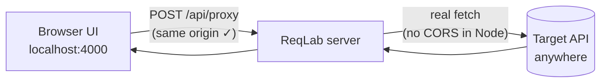
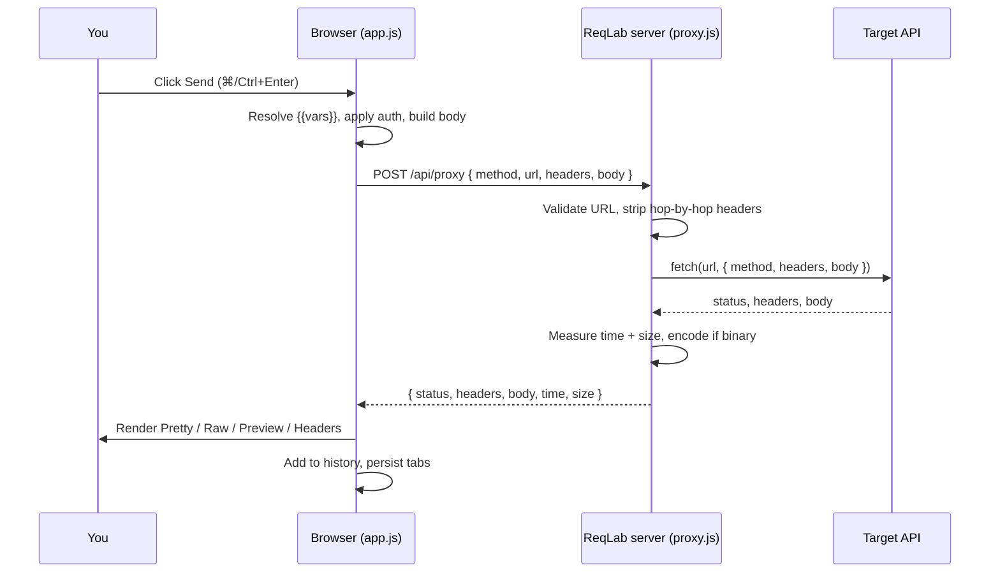

# 🧪 ReqLab — Complete Documentation

This document explains **everything** that was built for ReqLab: what it is, why
each piece exists, how the parts fit together, and how it was verified. It's a
companion to the [README](../README.md) — the README is the quick start, this is
the deep dive. For a short, plain-language guide, see [GUIDE.md](../GUIDE.md).

---

## Table of contents

1. [What ReqLab is](#1-what-reqlab-is)
2. [The core problem it solves (CORS)](#2-the-core-problem-it-solves-cors)
3. [Full feature list](#3-full-feature-list)
4. [High-level architecture](#4-high-level-architecture)
5. [The request lifecycle, step by step](#5-the-request-lifecycle-step-by-step)
6. [Project structure](#6-project-structure)
7. [Backend — file by file](#7-backend--file-by-file)
8. [Frontend — file by file](#8-frontend--file-by-file)
9. [Data model](#9-data-model)
10. [Security model](#10-security-model)
11. [Testing & verification](#11-testing--verification)
12. [Hosting & deployment](#12-hosting--deployment)
13. [Design decisions & trade-offs](#13-design-decisions--trade-offs)
14. [Possible extensions](#14-possible-extensions)

---

## 1. What ReqLab is

ReqLab is a **self-hosted, Postman-style API client**. It's a web app where you
build HTTP requests (method, URL, params, headers, auth, body), send them, and
inspect the response — with collections, environments, variables, history, and
code generation.

It is intentionally **small and dependency-light**:

- **Two runtime dependencies** — Express, and undici (the HTTP client behind
  Node's own `fetch`) for the connect-time SSRF check.
- **No frontend framework, no build step** — plain HTML/CSS/JavaScript served
  statically.
- **No database** — the server stores nothing; your data lives in your browser.
- **No account needed** — you run it; it's yours. An optional password
  (`REQLAB_PASSWORD`) keeps a hosted copy private.

The whole thing boots with `npm start` and runs on Node.js 22+ (20.18.1 or
newer works too).

---

## 2. The core problem it solves (CORS)

A browser **cannot** freely call arbitrary third-party APIs from a web page.
The **Same-Origin Policy** and **CORS** (Cross-Origin Resource Sharing) block a
page served from `localhost:4000` from reading a response from, say,
`api.github.com` unless that API explicitly allows your origin. Most APIs don't.

This is exactly why the Postman and Insomnia _desktop_ apps exist — they make
requests from a native process, not a browser tab, so CORS doesn't apply.

ReqLab solves it the same way a hosted API client does: with a **server-side
proxy**. The browser UI never calls the target API directly. Instead it sends
the fully-assembled request to ReqLab's own backend (same origin, no CORS
problem), and the backend performs the real request with Node's `fetch` and
returns the result.



---

## 3. Full feature list

Everything below is implemented and working.

### Request building

- All HTTP methods: **GET, POST, PUT, PATCH, DELETE, HEAD, OPTIONS**.
- URL bar with a method selector and **Send**.
- **Query params** editor (enable/disable per row), kept **two-way in sync** with
  the URL — edit the URL and the rows update; edit the rows and the URL updates.
- **Headers** editor with enable/disable per row.
- **Request body** modes:
  - `none`
  - `raw` — JSON / Text / XML / HTML / JavaScript, with a one-click **Beautify**
    for JSON, and an auto `Content-Type` based on the chosen sub-type.
  - `x-www-form-urlencoded` — key/value editor, URL-encoded on send.
  - `form-data` — multipart with text fields (the body and boundary are built in
    the browser).
- **Authorization**:
  - No Auth
  - **Bearer Token** → `Authorization: Bearer <token>`
  - **Basic Auth** → `Authorization: Basic base64(user:pass)`
  - **API Key** → added as a **header** or a **query param** (your choice)

### Response viewer

- **Status** (color-coded by 2xx/3xx/4xx/5xx/error), **time** (ms), and **size**.
- Four views: **Pretty** (JSON syntax-highlighted), **Raw**, **Preview**
  (sandboxed HTML render / inline image), **Headers** (table).
- One-click **Copy** of the body.
- A draggable **divider** to resize the request/response split.

### Organize & reuse

- **Multiple request tabs**, each with an unsaved-changes dot.
- **Collections** — save, open, rename, and delete requests.
- **History** — every send is recorded and can be re-opened in a new tab.
- **Environments & variables** — define `{{variables}}`; they resolve in the URL,
  params, headers, body, and auth at send time. Switch environments from the
  header dropdown.
- **Code generation** — export the current request as **cURL** or **JavaScript
  fetch**.
- **Import / Export** — ReqLab's own JSON format, plus best-effort **Postman v2**
  collection import.
- **Browser-only storage** — collections/environments/history and open tabs are
  all saved in **your browser's `localStorage`**. Nothing is sent to the server
  to be stored, so tokens/secrets never touch the host.
- **Keyboard shortcut** — `⌘/Ctrl + Enter` sends the active request.

### Backend

- A **proxy** endpoint that forwards requests and reports status, headers, body,
  timing, and byte size.
- **Stateless** — the server writes nothing to disk; there is no storage endpoint.
- Configurable **timeout** and **request/response size limits**.
- **Optional password protection** — a sign-in page, a signed session cookie,
  sign-out, session expiry, and a lockout after repeated wrong passwords.
- For public instances: an **SSRF guard** that blocks localhost/private
  addresses (it looks up domain names, checks every redirect hop, and checks
  the address again when connecting), a **demo-mode allow-list** of hosts, and
  a **rate limit**.
- **Browser protections** — a strict Content Security Policy and other security
  headers, a same-origin check against CSRF, and a Host check against DNS
  rebinding for local copies.
- **Docker** + compose for one-command hosting (non-root, read-only container).

---

## 4. High-level architecture

```mermaid
flowchart TB
    subgraph Browser["🌐 Browser (public/)"]
        direction TB
        APP[app.js — state, tabs, editors, rendering]
        VARS[variables.js — {{var}} resolution]
        CODE[codegen.js — cURL / fetch]
        HL[highlight.js — escape + JSON colors]
        API[api.js — backend client]
    end

    subgraph Server["🖥️ Node.js (src/) — stateless"]
        direction TB
        SRV[server.js — starts the server]
        APPJS[app.js — builds the Express app]
        SEC[api/security.js — headers, CSRF, rebinding]
        AUTH[api/auth.js — optional password]
        RT[api/routes.js]
        PX[api/proxy.js — the CORS bypass]
        GD[api/guard.js — SSRF guard, allow-list]
        CFG[config.js — env config]
    end

    TARGET[(Any HTTP API)]
    LS[(browser localStorage<br/>collections · env · history · tabs)]

    APP --> VARS & CODE & HL & API
    APP <--> LS
    API -->|/api/proxy| SEC --> AUTH --> RT --> PX --> TARGET
    PX --> GD
    SRV --> APPJS --> SEC
    SRV --> CFG
```

**Separation of concerns:**

- The **browser** owns everything about _building_ a request, _displaying_ a
  response, and _storing_ your data. It resolves variables, applies auth,
  assembles the body, renders the result, and persists to `localStorage`.
- The **server** is deliberately "dumb" and **stateless**: it forwards whatever
  fully-formed request it's handed and stores nothing. This keeps the security
  surface small and the logic easy to follow. Before anything reaches the
  proxy, the request passes the security headers, the CSRF and rebinding
  checks, and (with a password) the sign-in check.

---

## 5. The request lifecycle, step by step

When you click **Send**, here's exactly what happens:

1. **Read the active tab's request model** — method, URL, params, headers, auth,
   and body (a plain JS object held in memory).

2. **Build the "effective" request** (`buildEffective` in `app.js`):
   - Resolve `{{variables}}` against the active environment.
   - Apply **auth**: add an `Authorization` header (Bearer/Basic) or inject the
     API key into a header or the query string.
   - Assemble the **body** based on the mode and set a default `Content-Type`
     (unless you already supplied one):
     - `raw` → the text as-is, content type from the sub-type.
     - `urlencoded` → `key=value&...`, URL-encoded.
     - `form-data` → a multipart payload with a generated boundary.

3. **POST it to the local proxy** (`api.js` → `POST /api/proxy`) as JSON:
   `{ method, url, headers, body, timeout }`. This call is same-origin, so the
   browser allows it. The server first checks that it really came from
   ReqLab's own page (CSRF) and, when a password is set, that the session
   cookie is valid; only then does it read the body. If the sign-in has ended,
   the UI goes back to the sign-in page.

4. **The server forwards it** (`proxy.js`):
   - Apply the rate limit (if configured) and validate the URL, protocol and
     method.
   - Strip hop-by-hop headers (`Host`, `Content-Length`, `Connection`, …). Only
     the headers in the JSON are sent — never the browser's own headers or
     ReqLab's session cookie.
   - Run `fetch` with an `AbortController` timeout. Redirects (up to 20) are
     followed by the proxy itself, so each hop is checked against the
     allow-list and the SSRF guard before it is contacted. With the guard on,
     the address is checked once more as the connection is made.
   - Stream the response, keeping at most `maxResponseBytes`; measure **time**
     and **size**.
   - Return `{ ok, status, statusText, headers, contentType, time, size, url, redirected, body }`.
     Images come back base64-encoded (`bodyBase64`) for inline preview; oversized
     bodies are truncated with a `truncated` flag.

5. **The browser renders the response** (`renderResponse` in `app.js`):
   - Status/time/size in the meta bar.
   - **Pretty** view: if it looks like JSON, parse + re-stringify + syntax
     highlight; otherwise show text.
   - **Raw**, **Headers** (table), and **Preview** (sandboxed iframe for HTML, or
     an `` for images).

6. **Record history** and persist tabs — both to the browser's `localStorage`.



---

## 6. Project structure

```
reqlab/
├── src/
│   ├── server.js          # starts the server, prints its settings, graceful shutdown
│   ├── app.js             # builds the Express app: security, sign-in, API, static site
│   ├── config.js          # env-driven config (+ tiny .env loader)
│   └── api/
│       ├── proxy.js       # the request-forwarding proxy (CORS bypass, redirects, size cap)
│       ├── guard.js       # SSRF guard (up front and at connect time) + demo-mode allow-list
│       ├── auth.js        # optional password: sign-in page, session cookie, lockout
│       ├── security.js    # security headers (CSP), CSRF check, DNS-rebinding guard
│       ├── rateLimit.js   # visitor keys + in-memory rate limit for public instances
│       └── routes.js      # wires /health, /session and /proxy
├── public/                # the website (no build step)
│   ├── index.html         # full UI markup
│   ├── css/styles.css     # dark teal/sky theme
│   └── js/
│       ├── variables.js   # {{var}} substitution helper
│       ├── codegen.js     # cURL / fetch snippet generation
│       ├── highlight.js   # HTML-escaping + JSON syntax highlighting
│       ├── api.js         # thin client for the backend proxy
│       └── app.js         # main UI logic + localStorage persistence
├── .github/workflows/
│   └── test.yml           # CI: npm ci + npm test on Node 22 and 24
├── test/
│   ├── reqlab.test.js     # proxy and SSRF guard tests (node:test)
│   ├── app.test.js        # the whole app: password, CSRF, rebinding, headers
│   └── ui.test.js         # browser helpers (the JSON highlighter)
├── Dockerfile             # container image
├── docker-compose.yml     # one-command hosting
├── render.yaml            # Render Blueprint: public demo or private copy
├── .dockerignore
├── .env.example           # documented configuration template
├── .gitignore
├── GUIDE.md               # short user guide
├── package.json · package-lock.json
└── README.md
```

---

## 7. Backend — file by file

### `src/config.js`

Centralizes all configuration. It includes a **minimal `.env` loader** (so there
is no `dotenv` dependency) and exposes typed values with sensible defaults:
`port`, `host`, `proxyTimeoutMs`, `proxyMaxTimeout`, `maxResponseBytes`,
`maxBodyBytes`, `blockPrivateHosts`, the public-instance settings
`allowedHosts`, `rateLimitPerMinute`, `rateLimitTotalPerMinute`, and
`clientIpHeader`, and the password settings `password` (`REQLAB_PASSWORD`;
empty, `off` or `none` mean no password), `username`, `sessionSecret`, and
`sessionHours`. Everything has a zero-config default, so the app runs
immediately with no `.env` at all.

### Storage — there is none on the server

ReqLab's server is **stateless**: it never writes to disk. All of your data
(collections, environments, history, and open tabs) is stored in the browser's
`localStorage` by `app.js`, under two keys (`reqlab_store_v1` and
`reqlab_tabs_v1`). The practical consequences:

- **Your tokens/secrets never reach the host.** When you host ReqLab (e.g. on
  Render), nothing of yours is written there — your data lives on the machine
  whose browser you use.
- History stores the **unresolved** URL (keeping `{{variables}}` as-is), so a
  secret that a variable resolves to — like an API key in a query string — is
  never recorded.
- The trade-off is no cross-device sync: your data is tied to one browser
  (exactly like a local desktop app).

### `src/api/proxy.js`

The heart of the app — and the reason it works. `createProxyHandler(config, deps)`
returns an Express handler that:

- **Rate limits** (when configured): too many requests from one visitor, or for
  the whole server, in a minute get `429` with a `Retry-After` header.
- **Validates** the request: requires a URL, parses it, allows only
  `http:`/`https:`, and requires a valid HTTP method name (`CONNECT`, `TRACE`
  and `TRACK` are refused, as `fetch` refuses them).
- **Sanitizes headers** via `sanitizeHeaders`, removing hop-by-hop and managed
  headers (`Host`, `Content-Length`, `Connection`, `Accept-Encoding`, etc.) that
  must not be forwarded verbatim.
- **Forwards** with `fetch`, using an `AbortController` for a bounded timeout
  (capped by `proxyMaxTimeout`). It follows redirects itself (`redirect:
  'manual'`, up to 20), applying the same rules as `fetch` — a `303` (or a
  `301`/`302` after a `POST`) becomes a body-less `GET`, and `Authorization`/
  `Cookie` headers are not sent on to another site — and checks every hop
  against the allow-list and the SSRF guard (see `guard.js`). With the guard
  on, it sends requests through undici's `fetch` with an `Agent` whose
  `connect.lookup` is the guard's `createGuardedLookup`, so the address is
  checked again at the moment of connecting. The allow-list is only used when
  no password is set (a password-protected copy is private).
- **Measures** elapsed time and full byte size, then returns a structured JSON
  payload. Images are returned as base64 (`bodyBase64` + `isBinary`) so the UI
  can preview them. The body is streamed and only the first `maxResponseBytes`
  are kept, with a `truncated: true` flag, so a huge response can't use up the
  server's memory.
- **Maps errors** to meaningful HTTP statuses: `504` for timeouts, `502` for DNS/
  connection/TLS failures (with the underlying error code) or too many
  redirects, `400`/`403` for bad or blocked URLs (including a block found at
  connect time).

It also exports `isPrivateHost` and `sanitizeHeaders` as pure functions so they
can be unit-tested directly. `deps` lets tests swap in a fake `fetch` and DNS
`lookup`.

### `src/api/guard.js`

Decides which hosts the proxy may contact:

- `checkAllowedHost(hostname, allowedHosts)` — demo mode. When `ALLOWED_HOSTS`
  is set, only those exact host names (or subdomains, for `*.example.com`
  entries) are allowed.
- `checkHost(hostname)` — the SSRF guard, used when `BLOCK_PRIVATE_HOSTS` is on.
  IP literals are classified directly; domain names are looked up, and the host
  is blocked if **any** address it resolves to is loopback, private, link-local
  (including cloud metadata at `169.254.169.254`), shared/carrier-grade NAT,
  multicast or reserved. IPv6 is handled in every spelling, including bracketed
  hosts (`[::1]`), IPv4-mapped/compatible addresses, NAT64 and 6to4.
  Names such as `localhost`, `*.local`, and `*.internal` are blocked without a
  lookup.
- `createGuardedLookup()` — the same rule at connect time: a `lookup` function
  for `net.connect`/`tls.connect` that refuses to hand out private addresses.
  Because the connection only goes to addresses that passed the check, a
  domain can't resolve to a public address for the check and a private one for
  the connection (DNS rebinding).

### `src/api/rateLimit.js`

A small fixed-window limiter kept in memory (nothing is written to disk): at
most `RATE_LIMIT_PER_MINUTE` proxied requests per visitor and
`RATE_LIMIT_TOTAL_PER_MINUTE` for the whole server. Visitors are told apart by
`clientKey()`: `CLIENT_IP_HEADER` — a header the host's own proxy sets, such as
`cf-connecting-ip` on Render — or else the connecting address. An IPv6 visitor
counts as their whole `/64` network (one home usually has one), so they can't
dodge the limit by rotating addresses. The sign-in lockout uses the same keys.

### `src/api/routes.js`

Builds the Express router and wires three endpoints:

- `GET  /api/health` — liveness probe (open even with a password).
- `GET  /api/session` — `{ auth: false }`, or `{ auth: true, user, expiresAt }`
  when a password is set (the UI shows **Sign out** then).
- `POST /api/proxy` — the forwarding handler above.

There is **no storage endpoint** — the server is stateless. A small `handle()`
wrapper ensures any thrown error becomes a clean `400 { error }` JSON response
instead of an unhandled crash.

### `src/api/auth.js`

Optional password protection (`createAuth(config, deps)`). Without a password
it does nothing. With one:

- **Sign-in page** — `GET /login` renders a small form (escaped, no scripts);
  `POST /login` checks the user name (if set) and password. Both are compared
  as HMACs of equal length with `crypto.timingSafeEqual`, and both are always
  checked. Passwords shorter than 8 characters stop the server from starting,
  with a message that never includes the password.
- **Session cookie** — `v1.<payload>.<signature>`: the payload holds a random
  session id and the expiry (`SESSION_HOURS`, 12 by default), signed with
  HMAC-SHA256. The key is derived from `SESSION_SECRET` (or a random key made
  at startup) together with the user name and password, so changing the
  password ends every session. The cookie is `HttpOnly`, `SameSite=Strict`,
  `Path=/`, and behind HTTPS also `Secure` with the `__Host-` prefix.
- **Sign-out** — `POST /logout` clears the cookie and remembers the session id
  in memory until it would have expired, so a copied cookie stops working too.
- **Lockout** — after 5 wrong attempts a visitor waits 15 minutes (their
  attempts get `429` without the password even being checked); after 100 wrong
  attempts from everyone together in 15 minutes, all sign-ins pause until the
  window ends. Each wrong attempt is also answered a second late.
- **The gate** — `requireSignIn` lets through only `/api/health`, the sign-in
  page and its stylesheet. Pages redirect to `/login`; API calls get
  `401 { error, signIn }`.

### `src/api/security.js`

Protections for the browser side:

- `securityHeaders` — a Content Security Policy (`default-src 'self'`,
  `script-src 'self'`, `object-src 'none'`, `base-uri 'none'`,
  `form-action 'self'`, `frame-ancestors 'none'`; inline styles stay allowed
  for the HTML preview), plus `X-Content-Type-Options`, `X-Frame-Options`,
  `Referrer-Policy: same-origin`, `Cross-Origin-Opener-Policy`,
  `Cross-Origin-Resource-Policy`, `Permissions-Policy`, and
  `Strict-Transport-Security` over HTTPS (never for localhost).
- `sameOriginOnly` — CSRF protection for every state-changing request (the
  proxy, sign-in, sign-out): `Sec-Fetch-Site` must be `same-origin`, or for
  older browsers the `Origin` must match the `Host`. Requests with neither come
  from tools like curl, which can't ride on a visitor's cookie.
- `rebindingGuard` — for a local copy without a password and with private hosts
  allowed: only requests whose `Host` is an IP address or a local name
  (`localhost`, `*.local`, single-label names, …) are answered. A website that
  points its own domain at `127.0.0.1` (DNS rebinding) is refused, so it can't
  drive the proxy around your network.

### `src/app.js`

`createApp(config, deps)` builds the whole Express app without starting a
server, so the tests can run it too. In order: security headers, the rebinding
guard, the CSRF check, the sign-in routes and gate, then the API (with
`Cache-Control: no-store` and the JSON body limit from `MAX_BODY_BYTES`, read
only after sign-in), a JSON 404 for unknown API routes, and the static site
from `public/` with an SPA fallback to `index.html`.

### `src/server.js`

The entry point. It builds the app with `createApp(config)` (stopping with a
clear message if a setting can't work, such as a too-short password), starts an
HTTP server, prints a friendly banner (URL, that storage is stateless, whether
the password, SSRF guard, rate limit and allow-list are on), and installs
**graceful shutdown** on `SIGINT`/`SIGTERM`.

---

## 8. Frontend — file by file

### `public/index.html`

The full markup: header (brand, environment picker, import/export), a sidebar
(Collections / History tabs), the request builder (URL bar, Params/Auth/Headers/
Body sub-tabs), the response pane (Pretty/Raw/Preview/Headers), and three modals
(Save, Environments, Code). A **Sign out** button appears in the header when the
server has a password. Scripts are loaded in dependency order at the end; there
is no inline script, which the Content Security Policy requires.

### `public/js/variables.js` → `window.RL_vars`

Variable substitution. `resolve(str, map)` replaces `{{name}}` tokens using a
key→value map; **unknown variables are left untouched** so you can see what's
unresolved. `mapFromEnv(env)` builds the map from an environment's enabled
variables. `referenced(str)` lists which variables a string uses.

### `public/js/codegen.js` → `window.RL_codegen`

Turns an _effective_ request into a snippet. `curl()` builds a multi-line
`curl -X … -H … --data …` command with proper shell quoting; `fetchSnippet()`
builds an `await fetch(url, { … })` example. Both consume the same assembled
request the proxy receives, so the generated code matches what ReqLab actually
sends.

### `public/js/highlight.js` → `window.RL_highlight`

Safety + presentation. `escapeHtml()` escapes `& < > " '` so response bodies can
never inject markup. `highlightJSON()` finds the tokens (keys, strings, numbers,
booleans, null) in the raw JSON first, then escapes every token and every gap
between them on its own and wraps tokens in `<span class="tok-…">` for
coloring. Only our own `<span>` tags end up as markup, so highlighting is
XSS-safe (and text such as `it's` displays correctly).

### `public/js/api.js` → `window.RL_api`

A thin wrapper over `fetch`: `proxy(payload)` calls `POST /api/proxy` (and
returns the payload, which may carry a handled `error` rather than throwing),
and `session()` asks `GET /api/session` whether a password is in use. A `401`
(the sign-in has ended) sends the browser to the sign-in page. There are no
storage calls — the server has no store.

### `public/js/app.js` → the main application

This is where most of the UI logic lives. Key responsibilities:

- **State model** — `state` holds tabs, collections, environments, history, and
  the active selections. A request is a plain object: `{ method, url, params,
headers, auth, body }`.
- **Tabs** — open/close/switch, an unsaved **dirty** dot, and restoration from
  `localStorage` on reload.
- **Reusable key/value editor** (`renderKV`) — used for params, headers,
  urlencoded, form-data, and environment variables. It always shows one "ghost"
  row that promotes to a real row as you type, with enable/disable and delete.
- **URL ↔ params two-way sync** — editing either side updates the other, while
  **preserving `{{variables}}`** through encoding.
- **Auth & body assembly** (`buildEffective`) — described in the lifecycle above.
- **Response rendering** — Pretty/Raw/Preview/Headers, status coloring, sizes,
  truncation banners, and a **sandboxed iframe** for HTML previews.
- **Collections, History, Environments, Save/Code modals, Import/Export** —
  including a `convertPostman()` that maps a Postman v2 collection into ReqLab's
  model.
- **Untrusted data handling** — imported files and saved data pass through
  `normalizeRequest()` and friends, which give every field the expected type
  (a method must look like an HTTP method name, lists must be lists, …), and
  every value placed into HTML is escaped. A hostile collection file can't
  inject markup or break the page.
- **Persistence** — everything (collections, environments, history, tabs) is
  saved to the browser's `localStorage`; nothing is sent to the server.

---

## 9. Data model

The browser's `localStorage` store (key `reqlab_store_v1`) is a single JSON object:

```jsonc
{
  "collections": [
    {
      "id": "ABC123",
      "name": "My API",
      "requests": [
        {
          "id": "REQ1",
          "name": "Get user",
          "request": {
            /* request model */
          },
        },
      ],
    },
  ],
  "environments": [
    {
      "id": "ENV1",
      "name": "Production",
      "variables": [
        {
          "key": "baseUrl",
          "value": "https://api.example.com",
          "enabled": true,
        },
      ],
    },
  ],
  "history": [
    {
      "id": "H1",
      "ts": 1718000000000,
      "method": "GET",
      "url": "…",
      "status": 200,
      "ok": true,
      "request": {
        /* … */
      },
    },
  ],
}
```

The **request model** (used in tabs, collections, and history) looks like:

```jsonc
{
  "method": "POST",
  "url": "https://api.example.com/users?page=2",
  "params": [{ "key": "page", "value": "2", "enabled": true }],
  "headers": [
    { "key": "Accept", "value": "application/json", "enabled": true },
  ],
  "auth": {
    "type": "bearer",
    "token": "{{token}}",
    "username": "",
    "password": "",
    "key": "",
    "value": "",
    "addTo": "header",
  },
  "body": {
    "mode": "raw",
    "raw": "{ \"name\": \"Ada\" }",
    "rawType": "json",
    "formData": [],
    "urlencoded": [],
  },
}
```

---

## 10. Security model

ReqLab is an API client, so it intentionally sends requests anywhere — but the
implementation is careful about the things that matter:

- **The server stores nothing.** It's stateless — collections, environments, and
  history live only in your browser's `localStorage`. Your tokens and secrets are
  never written to the host's disk, so a hosted instance (e.g. on Render) holds
  none of your data. The server doesn't log requests either.
- **Optional password.** With `REQLAB_PASSWORD`, every page and API call except
  `/api/health` needs a session from the sign-in page. The cookie is signed
  (HMAC-SHA256), `HttpOnly`, `SameSite=Strict`, and `Secure` with the `__Host-`
  prefix behind HTTPS; it expires after `SESSION_HOURS` (12 by default), sign-out
  ends it on the server too, and changing the password ends every session.
  Passwords are compared in constant time, wrong guesses are slowed down and
  locked out (5 per visitor per 15 minutes, 100 for everyone together), the
  password is never logged, and request bodies are only read after sign-in.
- **CSRF.** The proxy, sign-in and sign-out only accept requests from ReqLab's
  own pages (`Sec-Fetch-Site: same-origin`, or a matching `Origin`), on top of
  the `SameSite=Strict` cookie.
- **DNS rebinding of a local copy.** Without a password and with private hosts
  allowed, ReqLab only answers requests whose `Host` is an IP address or a local
  name. A website can't point its own domain at `127.0.0.1` and then use your
  ReqLab to reach your network.
- **Response rendering is XSS-safe.** Every value shown in the UI — from
  responses and from imported files — is HTML-escaped before display, and
  imported data is normalized to the expected types. The **Preview** tab renders
  HTML inside an `<iframe sandbox>` with **no allowances**, so response scripts
  cannot execute or touch the ReqLab page.
- **Security headers.** A Content Security Policy allows only ReqLab's own
  scripts, no plugins, no outside connections and no framing; inline styles stay
  allowed so the HTML preview (which inherits the policy) shows a page's own
  styles, while outside images, styles and fonts are not loaded. `nosniff`,
  `X-Frame-Options: DENY`, `Referrer-Policy: same-origin`, COOP/CORP,
  `Permissions-Policy`, and HSTS over HTTPS complete the set; API answers are
  `Cache-Control: no-store`.
- **Header hygiene.** Only the headers in the request you built are sent to the
  target — never ReqLab's session cookie or your browser's headers. Hop-by-hop
  and managed headers are stripped before forwarding.
- **SSRF guard.** `BLOCK_PRIVATE_HOSTS=true` makes the proxy refuse loopback,
  private, link-local (cloud metadata), shared, multicast and reserved
  addresses, in IPv4 and every IPv6 spelling. Domain names are looked up and
  blocked if any address is private, redirects are followed by the proxy itself
  so every hop is checked, and the address is checked once more at connect time
  (`createGuardedLookup`), so DNS rebinding can't slip a private address in
  between. It's **off by default** so local development against your own
  `localhost` APIs works; turn it **on** for any hosted copy.
- **Demo-mode allow-list.** `ALLOWED_HOSTS` limits a password-free public demo to
  named hosts, so it can't be used as an open proxy. With a password the copy is
  private, so the list is not used.
- **Bounded resource use.** Per-request timeouts (capped server-side), a
  streamed response capped at `MAX_RESPONSE_BYTES`, a request size limit
  (`MAX_BODY_BYTES`), and an optional per-visitor and server-wide rate limit
  protect the server from hung, huge, or repeated requests.
- **Deployment.** The Docker image installs only locked production dependencies
  (`npm ci --omit=dev`) and runs as the unprivileged `node` user; compose keeps
  the container read-only, drops all capabilities and sets
  `no-new-privileges`. `npm audit --omit=dev` reports no known vulnerabilities.
- **What's left to you.** Pick a long password, keep `REQLAB_PASSWORD`,
  `SESSION_SECRET` and exported files private, and serve a hosted copy over
  HTTPS (Render does this). A password-free public copy should keep the
  allow-list and the rate limit, as `render.yaml` does.

---

## 11. Testing & verification

### Automated tests (`npm test`, `node:test`)

All passing, and run by GitHub Actions on Node 22 and 24 for every push and pull
request (`.github/workflows/test.yml`). Three files:

**`test/reqlab.test.js` — the proxy and the SSRF guard**

- `isPrivateHost` correctly classifies loopback / private / public addresses
  (including the `172.16–31` boundary, bracketed and IPv4-mapped IPv6,
  carrier-grade NAT, and `*.internal` names).
- `checkHost` blocks a domain when any address it resolves to is private.
- A domain that passes the up-front check but would connect to `127.0.0.1` is
  refused at connect time, and the private server is never contacted.
- `sanitizeHeaders` strips hop-by-hop headers and keeps user headers.
- Every redirect hop passes the SSRF guard: a public host that redirects to
  `127.0.0.1` is refused, and the private address is never contacted.
- The allow-list accepts listed hosts and `*.domain` subdomains, rejects
  look-alikes, is applied to redirects, and is not used with a password.
- Redirect following matches `fetch`: a `303` after a `POST` becomes a `GET`
  with no body, `Authorization` is dropped when the redirect changes site, and
  the payload reports the final `url` and `redirected: true`.
- Responses larger than `maxResponseBytes` are truncated and flagged.
- The rate limit answers `429` with `Retry-After` once a visitor uses up their
  requests, without affecting other visitors.
- Invalid method names and `CONNECT`/`TRACE` are refused with `400`.
- An **end-to-end integration test** spins up a local echo server and the ReqLab
  app, then verifies: a POST is forwarded with its body + `Authorization`; an
  invalid URL returns `400`; there is **no `/api/store` endpoint** (the server is
  stateless); and private hosts are blocked when the guard is on.

**`test/app.test.js` — the whole app**

- Pages redirect to `/login` and API calls get `401` without a session; the
  health check, the sign-in page and its stylesheet stay open.
- Signing in sets a signed `HttpOnly`, `SameSite=Strict` cookie, with `Secure`
  and the `__Host-` prefix behind HTTPS; a wrong password sets nothing.
- The session cookie and the visitor's headers never reach the target API.
- Tampered, expired and signed-out sessions are refused; `SESSION_SECRET` keeps
  sessions across restarts; a new password ends them; a user name is required
  when one is set.
- 5 wrong passwords lock a visitor out for 15 minutes (even the right password
  is then refused) without affecting others; failed attempts are slowed down;
  the server-wide cap pauses sign-ins; a too-short password stops the server
  from starting without printing it.
- Request bodies are only read after sign-in (`401`, not `413`, for strangers).
- Cross-site requests (`Sec-Fetch-Site`, `Origin`, `Origin: null`) are refused
  for the proxy, sign-in and sign-out; same-origin requests and tools like curl
  pass.
- Security headers are present, API answers are not cached, HSTS is only sent
  over HTTPS and never for localhost, and the sign-in page warns when it isn't
  on HTTPS.
- The DNS-rebinding guard answers local names and IP addresses only, and is not
  applied with a password or the SSRF guard on.
- IPv6 visitors are grouped by `/64`.

**`test/ui.test.js` — browser helpers**

- The JSON highlighter escapes every character of a hostile response, colours
  each token, and round-trips the original text exactly.

### Live browser verification

The running app was driven in a real browser (Chromium) to confirm:

- The **sample GET** returns `200` with highlighted JSON.
- A **POST with a JSON body** returns `201` and the body is echoed back by the
  target.
- **Params → URL sync** works (typing a param updated the URL and the count
  badge).
- **Variable resolution** and **cURL generation** produce correct output.
- A **clean cold boot** serves `/api/health` and the static `index.html`.
- With a password: the sign-in page, a wrong and a right password, **Sign out**,
  and the redirect back to sign-in all work; the HTML preview renders under the
  Content Security Policy without running scripts; and a hostile Postman
  collection (markup in names and methods) imports as plain text.

---

## 12. Hosting & deployment

### Docker (recommended)

```bash
docker compose up --build
# → http://localhost:4000
```

The `Dockerfile` installs only the locked production dependencies
(`npm ci --omit=dev`) on Node 22 Alpine, copies just `src/` and `public/`, runs
as the unprivileged `node` user, exposes `4000`, and includes a `HEALTHCHECK`.
Compose reads settings from an optional `.env` file, keeps the container
read-only, drops all capabilities and sets `no-new-privileges`. No volume is
needed because the server is stateless.

### Render (one click)

[`render.yaml`](../render.yaml) is a Render Blueprint, so the **Deploy to
Render** button in the README creates a free web service. It asks for
`REQLAB_PASSWORD` (a `sync: false` value):

- **Empty (or `off`) — a public demo:** `BLOCK_PRIVATE_HOSTS=true`, a short
  `ALLOWED_HOSTS` list of well-known test APIs, a 2 MB response cap, a 1 MB
  request cap, and rate limits of 20 requests a minute per visitor and 120 for
  the whole server.
- **A password — your own private copy:** the same, but every page and API call
  needs a sign-in, and the allow-list is not used, so you can call any API.

`SESSION_SECRET` is generated by Render (`generateValue: true`), so sign-ins
survive the free service sleeping and waking. Free services sleep after 15 idle
minutes and take about a minute to wake. To change the password later, edit
`REQLAB_PASSWORD` on the service's Environment page (`sync: false` values are
never overwritten by Blueprint syncs).

### Any Node host (Render, Railway, Fly.io, a VPS…)

- **Build:** `npm ci --omit=dev`
- **Start:** `npm start`
- The app reads `process.env.PORT`. **No persistent disk is required** — the
  server stores nothing. Your data lives in your browser, so a hosted instance
  holds none of it.
- For hosted deployments, set `BLOCK_PRIVATE_HOSTS=true` and either a password
  or `ALLOWED_HOSTS` with the rate limit, and serve over HTTPS.
- Behind your own reverse proxy, pass the original `Host` header and
  `X-Forwarded-Proto` (so the cookie is `Secure` and the CSRF check sees the
  right host; Caddy and Traefik do this by default, nginx needs
  `proxy_set_header Host $host;` and `proxy_set_header X-Forwarded-Proto $scheme;`),
  and set `CLIENT_IP_HEADER` to a header your proxy sets to the visitor's
  address (such as `x-real-ip`), so the rate limit and the lockout tell
  visitors apart.

---

## 13. Design decisions & trade-offs

- **Server-side proxy over a browser-only app** — the only way to call arbitrary
  APIs from a web UI without CORS pain. It also lets us measure true timing and
  size and preview binary content.
- **Plain JS, no framework/build** — keeps the project approachable, fast to
  load, and trivial to host. The reusable `renderKV` editor and a small `state`
  object cover what a framework would otherwise manage.
- **Browser storage instead of a database** — zero setup, nothing to back up on
  the server, and your secrets never reach the host. The trade-off is no sync
  between browsers; **Export/Import** moves your work.
- **Signed cookies instead of server-side sessions** — the server stays
  stateless (sessions survive restarts with `SESSION_SECRET`), and only
  sign-outs and failed attempts are kept, in memory. The trade-off: after a
  restart, a signed-out cookie that someone copied would work again until it
  expires; changing the password ends every session for sure.
- **One switch for public vs. private** — with a password the copy is private,
  so the demo allow-list is not used. That way a Render copy becomes fully
  usable just by setting `REQLAB_PASSWORD`; deleting `ALLOWED_HOSTS` by hand
  would be undone by the next Blueprint sync.
- **A connect-time SSRF check via undici** — Node's built-in `fetch` has no way
  to vet the address it connects to, so the guarded path uses undici (the same
  client, from npm) with a `connect.lookup` hook. Local copies without the guard
  keep using the built-in `fetch`.
- **Predefined, structured request model** — makes variable resolution, code
  generation, import/export, and persistence straightforward and deterministic.
- **Text-only `form-data`** — multipart text fields are assembled in the browser;
  binary file uploads were left out to keep the proxy contract simple (a clear,
  documented limitation rather than a half-working feature).

---

## 14. Possible extensions

The codebase is structured so these slot in cleanly:

- **File uploads** in `form-data` (stream multipart through the proxy).
- **More code targets** (Python `requests`, Go, PHP) — add generators to
  `codegen.js`.
- **Request scripting / tests** (assertions on the response).
- **Folder nesting** inside collections.
- **Cookie jar** and redirect-history display.
- **Auth helpers** (OAuth 2.0 flows).
- **Per-collection variables** layered under environment variables.

---

_ReqLab — built to be small, readable, and genuinely useful. MIT licensed._
